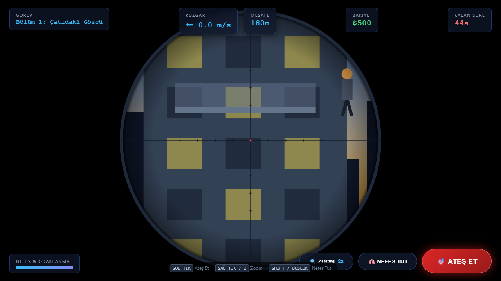

# 🎯 Shadow Sniper 2.5D — YouTube Playables

Modern, hafif ve yüksek performanslı **2.5D Keskin Nişancı Simülasyonu**. YouTube Playables standartlarına uygun olarak tasarlanmış, hem masaüstü hem de mobil dokunmatik ekran uyumlu bir HTML5 web oyunudur.



---

## 🌟 Öne Çıkan Özellikler

* **20 Özgün Görev:**
  * Çatı gözcüleri, çantalı kuryeler, VIP otel balkonları, kalabalıkta gizlenen muhbirler.
  * Hassas kafa vuruşu gerektiren **Rehine Kurtarma**, hızlı metro firarileri, gizlenen sabotajcılar.
  * **Kırmızı Lazerli Düşman Sniper Düellosu** ve **Helikopter Kaçışı Finali**.
* **Ekonomi & Silah Geliştirme:**
  * 4 Farklı Keskin Nişancı Tüfeği: *Scout SR-21*, *AWM .338 Lapua*, *Barrett M82 .50 Cal*, *Ghost Reaper X*.
  * Yükseltmeler: Hidrolik Kundak (Sallantı önleyici), Oksijen Regülatörü (Nefes süresi artırıcı), Taktik Susturucu (+%25 Ödül).
* **Taktik Telsiz Seslendirmeleri (`edge-tts`):**
  * Türkçe profesyonel askeri telsiz anonsları (Görev başı, kafa vuruşu, ıska uyarısı, rehine vurulma alarmı).
* **YouTube Playables Entegrasyonu:**
  * 2.1 MB ultra hafif boyut, 1 saniyenin altında açılış.
  * Mobil & masaüstü duyarlı arayüz.
  * Otomatik kayıt (`localStorage` ve Playables SDK hazır).
* **Otomatik Test:**
  * Playwright tabanlı QA botu ile test edilmiş ve sıfır hata ile onaylanmıştır.

---

## 🎮 Kontroller

| Eylem | Masaüstü (PC) | Mobil (Dokunmatik) |
|---|---|---|
| **Nişan Alma** | Fare Hareketi | Ekranda Parmağı Kaydır |
| **Ateş Etme** | Fare Sol Tık / Boşluk | `🎯 ATEŞ ET` Butonu |
| **Zoom Değiştirme** | Fare Sağ Tık / Z Tuşu | `🔍 ZOOM` Butonu |
| **Nefes Tutma** | Shift Tuşu (Zaman yavaşlar) | `🫁 NEFES TUT` Butonu |

---

## 🚀 Çalıştırma

Herhangi bir kurulum gerektirmeden doğrudan `index.html` dosyasını tarayıcınızda açabilirsiniz.

Yerel sunucuyla başlatmak için:
```bash
python -m http.server 8080
```
Tarayıcınızda: `http://localhost:8080`

---

## 🤖 Yapay Zeka Test & Ses Üretimi

* Telsiz seslerini yeniden üretmek için:
  ```bash
  python generate_voices.py
  ```
* Otomatik QA testini çalıştırmak ve ekran görüntüleri almak için:
  ```bash
  python qa_test.py
  ```
